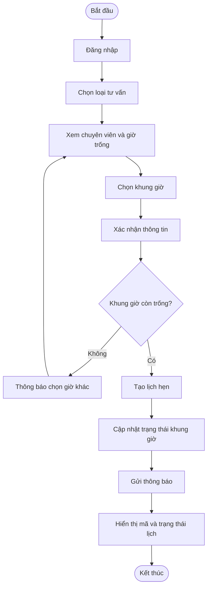
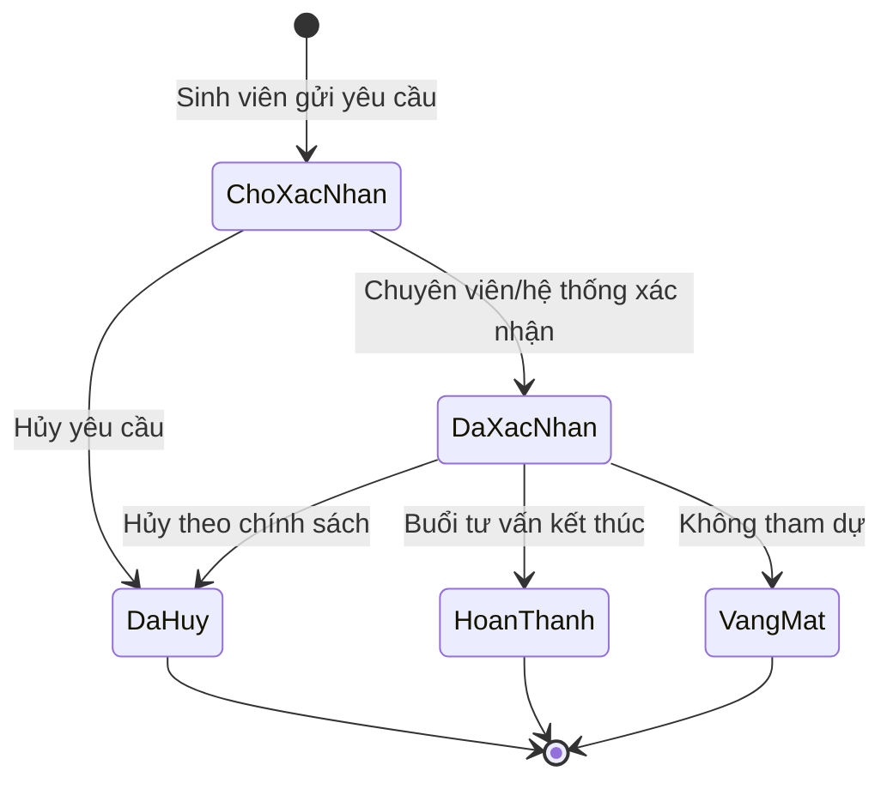
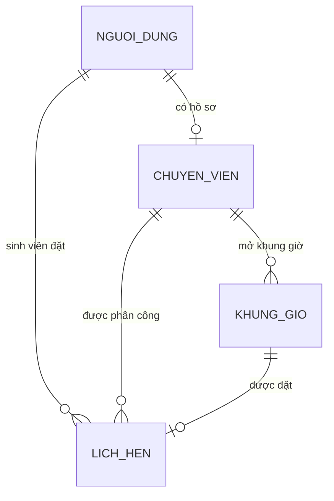

# ĐỒ ÁN: HỆ THỐNG ĐẶT LỊCH TƯ VẤN TÂM LÝ VÀ PHÁP LÝ CHO SINH VIÊN

> **Tài liệu phân tích và thiết kế hệ thống**  
> Phiên bản: 1.0 (bản dự thảo)  
> Ngôn ngữ: Tiếng Việt  
> Trạng thái: Đang hoàn thiện yêu cầu

---

## Mục lục

1. [Giới thiệu đề tài](#1-giới-thiệu-đề-tài)
2. [Lý do chọn đề tài](#2-lý-do-chọn-đề-tài)
3. [Mục tiêu và phạm vi](#3-mục-tiêu-và-phạm-vi)
4. [Đối tượng sử dụng](#4-đối-tượng-sử-dụng)
5. [Yêu cầu hệ thống](#5-yêu-cầu-hệ-thống)
6. [Quy trình nghiệp vụ](#6-quy-trình-nghiệp-vụ)
7. [Chức năng từng phân hệ](#7-chức-năng-từng-phân-hệ)
8. [Sơ đồ hoạt động](#8-sơ-đồ-hoạt-động)
9. [Thiết kế dữ liệu](#9-thiết-kế-dữ-liệu)
10. [Thiết kế API tham khảo](#10-thiết-kế-api-tham-khảo)
11. [Mã minh họa và giải thích trình tự](#11-mã-minh-họa-và-giải-thích-trình-tự)
12. [Giao diện dự kiến](#12-giao-diện-dự-kiến)
13. [Bảo mật và quyền riêng tư](#13-bảo-mật-và-quyền-riêng-tư)
14. [Kế hoạch kiểm thử](#14-kế-hoạch-kiểm-thử)
15. [Kế hoạch thực hiện](#15-kế-hoạch-thực-hiện)
16. [Cấu trúc thư mục dự án](#16-cấu-trúc-thư-mục-dự-án)
17. [Hướng dẫn xem tài liệu bằng Visual Studio Code](#17-hướng-dẫn-xem-tài-liệu-bằng-visual-studio-code)
18. [Các nội dung cần xác nhận](#18-các-nội-dung-cần-xác-nhận)
19. [Tài liệu tham khảo của đề tài](#19-tài-liệu-tham-khảo-của-đề-tài)

---

## 1. Giới thiệu đề tài

### 1.1 Tên đề tài

**Hệ thống đặt lịch tư vấn tâm lý và pháp lý cho sinh viên**

### 1.2 Mô tả tổng quát

Đây là hệ thống hỗ trợ sinh viên tìm hiểu dịch vụ tư vấn của nhà trường, chọn lĩnh vực cần hỗ trợ, xem thời gian còn trống và gửi yêu cầu đặt lịch với chuyên viên. Sau khi đặt lịch, sinh viên có thể theo dõi trạng thái, xem lại thông tin lịch hẹn, đổi hoặc hủy lịch theo quy định.

Hệ thống có ba nhóm người dùng chính:

- **Sinh viên:** tìm dịch vụ, đặt lịch và quản lý lịch cá nhân.
- **Chuyên viên tư vấn:** quản lý giờ làm việc và xử lý các lịch được phân công.
- **Quản trị viên:** quản lý tài khoản, dịch vụ, lịch và cấu hình chung.

> **Lưu ý về trạng thái dự án:** Nội dung dưới đây là tài liệu phân tích/thiết kế dự kiến theo tên đề tài. Cần đối chiếu với PRD và tài liệu ghi chú đính kèm trong Issue #1 trước khi chốt yêu cầu. Các ví dụ mã là minh họa luồng xử lý, chưa phải mã triển khai hoàn chỉnh.

### 1.3 Từ viết tắt

| Từ viết tắt | Ý nghĩa |
|---|---|
| UI | Giao diện người dùng |
| API | Giao diện để các ứng dụng trao đổi dữ liệu |
| CSDL | Cơ sở dữ liệu |
| FR | Yêu cầu chức năng (Functional Requirement) |
| NFR | Yêu cầu phi chức năng (Non-functional Requirement) |
| CRUD | Tạo, đọc, cập nhật, xóa dữ liệu |

---

## 2. Lý do chọn đề tài

Sinh viên có thể gặp khó khăn trong học tập, cuộc sống, sức khỏe tinh thần hoặc các vấn đề pháp lý nhưng chưa biết tìm đúng đầu mối hỗ trợ. Việc đặt lịch qua nhiều kênh thủ công có thể gây bất tiện, khó theo dõi lịch trống và dễ xảy ra trùng lịch.

Hệ thống được đề xuất nhằm:

1. Tập trung thông tin về dịch vụ tư vấn tại một nơi.
2. Giúp sinh viên chủ động chọn thời gian phù hợp.
3. Giúp chuyên viên quản lý lịch làm việc có tổ chức.
4. Giảm thao tác thủ công trong việc tiếp nhận và xác nhận lịch.
5. Hạn chế lộ thông tin riêng tư của người sử dụng dịch vụ.

---

## 3. Mục tiêu và phạm vi

### 3.1 Mục tiêu

- Xây dựng quy trình đặt lịch rõ ràng, dễ sử dụng.
- Hiển thị các khung giờ còn trống và ngăn hai người đặt cùng một khung giờ.
- Cho phép các vai trò sử dụng đúng chức năng được phân quyền.
- Thông báo cho sinh viên khi lịch được tạo, xác nhận, thay đổi hoặc hủy.
- Bảo vệ thông tin cá nhân và thông tin nhạy cảm bằng các biện pháp phù hợp.

### 3.2 Phạm vi chức năng dự kiến

| Mã | Phạm vi | Mô tả |
|---|---|---|
| P-01 | Tài khoản | Đăng nhập, đăng xuất, quản lý hồ sơ cơ bản |
| P-02 | Dịch vụ | Xem các dịch vụ tư vấn tâm lý và pháp lý |
| P-03 | Chuyên viên | Xem hồ sơ giới thiệu và lịch làm việc được công khai |
| P-04 | Đặt lịch | Chọn dịch vụ, chuyên viên, khung giờ và gửi yêu cầu |
| P-05 | Quản lý lịch | Xem, đổi hoặc hủy lịch theo chính sách |
| P-06 | Quản lý chuyên viên | Cập nhật giờ làm việc và xử lý lịch được phân công |
| P-07 | Quản trị | Quản lý người dùng, dịch vụ và cấu hình hệ thống |
| P-08 | Thông báo | Thông báo các sự kiện cần thiết liên quan đến lịch hẹn |

### 3.3 Ngoài phạm vi bản đầu (cần xác nhận)

- Chẩn đoán hoặc điều trị tâm lý tự động.
- Đưa ra kết luận pháp lý tự động có tính ràng buộc.
- Thanh toán trực tuyến.
- Ghi âm hoặc ghi hình buổi tư vấn.
- Lưu trữ hồ sơ tư vấn chi tiết hoặc hồ sơ y tế/pháp lý.
- Tích hợp với hệ thống quản lý sinh viên khác.

---

## 4. Đối tượng sử dụng

### 4.1 Sinh viên

Sinh viên cần xem dịch vụ, chọn lịch trống, gửi yêu cầu đặt lịch và nhận thông báo về tình trạng lịch. Sinh viên chỉ được xem và quản lý lịch thuộc tài khoản của mình.

### 4.2 Chuyên viên tư vấn

Chuyên viên cần khai báo thời gian làm việc, xem lịch được phân công và cập nhật trạng thái buổi hẹn. Chuyên viên không được truy cập lịch của người dùng không liên quan đến công việc được giao.

### 4.3 Quản trị viên

Quản trị viên quản lý danh mục dịch vụ, tài khoản và cấu hình vận hành. Quyền xem thông tin nhạy cảm cần được hạn chế ở mức tối thiểu; mọi truy cập quản trị quan trọng nên được ghi nhật ký.

### 4.4 Bảng quyền dự kiến

| Chức năng | Sinh viên | Chuyên viên | Quản trị viên |
|---|:---:|:---:|:---:|
| Xem dịch vụ công khai | ✓ | ✓ | ✓ |
| Đặt lịch tư vấn | ✓ | — | — |
| Xem lịch của bản thân | ✓ | — | — |
| Xem lịch được phân công | — | ✓ | ✓* |
| Quản lý giờ làm việc | — | ✓ | ✓ |
| Quản lý tài khoản/dịch vụ | — | — | ✓ |

`*` Quyền của quản trị viên cần giới hạn theo chính sách và có ghi nhật ký truy cập.

---

## 5. Yêu cầu hệ thống

### 5.1 Yêu cầu chức năng

| Mã | Tên yêu cầu | Mô tả | Mức ưu tiên |
|---|---|---|---|
| FR-01 | Đăng nhập | Người dùng xác thực trước khi sử dụng chức năng cá nhân | Cao |
| FR-02 | Quản lý hồ sơ | Người dùng xem/cập nhật thông tin được phép | Cao |
| FR-03 | Xem dịch vụ | Hiển thị loại tư vấn, mô tả, thời lượng và hình thức | Cao |
| FR-04 | Tìm chuyên viên | Tìm theo lĩnh vực và tiêu chí công khai | Trung bình |
| FR-05 | Xem giờ trống | Hiển thị các khung giờ khả dụng của chuyên viên | Cao |
| FR-06 | Tạo lịch hẹn | Gửi yêu cầu đặt một khung giờ còn trống | Cao |
| FR-07 | Chống trùng lịch | Không cho phép nhiều lịch hợp lệ chiếm cùng một khung giờ | Cao |
| FR-08 | Quản lý lịch cá nhân | Sinh viên xem, đổi hoặc hủy lịch theo quy định | Cao |
| FR-09 | Xử lý lịch | Chuyên viên xác nhận/cập nhật trạng thái lịch được phân công | Cao |
| FR-10 | Quản lý giờ làm việc | Chuyên viên cập nhật khung giờ khả dụng | Trung bình |
| FR-11 | Gửi thông báo | Báo cho người dùng khi lịch có thay đổi | Trung bình |
| FR-12 | Quản trị hệ thống | Quản lý tài khoản, dịch vụ và cấu hình | Trung bình |
| FR-13 | Nhật ký thao tác | Lưu sự kiện quan trọng phục vụ kiểm tra vận hành | Trung bình |

### 5.2 Yêu cầu phi chức năng

- **NFR-01 – Bảo mật:** xác thực người dùng, phân quyền phía máy chủ và bảo vệ dữ liệu khi truyền nhận.
- **NFR-02 – Riêng tư:** chỉ thu thập dữ liệu cần thiết, công bố mục đích sử dụng và giới hạn người có quyền truy cập.
- **NFR-03 – Toàn vẹn:** thao tác đặt lịch phải tránh đặt trùng kể cả khi có nhiều yêu cầu cùng lúc.
- **NFR-04 – Khả dụng:** hệ thống hiển thị thông báo lỗi dễ hiểu và không tạo dữ liệu dở dang khi thao tác thất bại.
- **NFR-05 – Dễ sử dụng:** giao diện tiếng Việt, dễ đọc, tương thích điện thoại và máy tính.
- **NFR-06 – Dễ bảo trì:** tách giao diện, xử lý nghiệp vụ và truy cập dữ liệu.
- **NFR-07 – Khả năng truy vết:** ghi lại các thay đổi quan trọng, nhưng không ghi nội dung tư vấn nhạy cảm vào log.

---

## 6. Quy trình nghiệp vụ

### 6.1 Quy trình đặt lịch của sinh viên

1. Sinh viên mở hệ thống.
2. Sinh viên đăng nhập.
3. Sinh viên chọn nhóm dịch vụ tâm lý hoặc pháp lý.
4. Hệ thống hiển thị thông tin dịch vụ và chuyên viên phù hợp.
5. Sinh viên chọn chuyên viên (nếu nghiệp vụ cho phép chọn).
6. Hệ thống hiển thị các khung giờ còn trống.
7. Sinh viên chọn ngày và giờ.
8. Hệ thống hiển thị trang xác nhận để sinh viên kiểm tra lại thông tin.
9. Sinh viên xác nhận gửi yêu cầu.
10. Máy chủ kiểm tra lại quyền, dữ liệu và tình trạng khung giờ.
11. Nếu khung giờ còn trống, hệ thống tạo lịch và cập nhật khung giờ.
12. Hệ thống hiển thị mã lịch và trạng thái cho sinh viên.
13. Hệ thống gửi thông báo cần thiết cho sinh viên/chuyên viên.

### 6.2 Quy trình đổi hoặc hủy lịch

1. Sinh viên mở danh sách lịch cá nhân.
2. Sinh viên chọn lịch muốn thay đổi.
3. Hệ thống kiểm tra lịch thuộc về sinh viên đang đăng nhập.
4. Hệ thống kiểm tra chính sách đổi/hủy và thời hạn cho phép.
5. Nếu hợp lệ, hệ thống cập nhật lịch và giải phóng khung giờ cũ (nếu cần).
6. Hệ thống lưu lịch sử thay đổi và thông báo cho các bên liên quan.

### 6.3 Quy trình của chuyên viên

1. Chuyên viên đăng nhập tài khoản được cấp.
2. Chuyên viên cập nhật các khung giờ làm việc.
3. Hệ thống chỉ cho hiển thị những khung giờ hợp lệ và chưa bị đặt.
4. Chuyên viên xem danh sách lịch được phân công.
5. Chuyên viên xác nhận hoặc cập nhật trạng thái theo quy trình được thống nhất.
6. Hệ thống lưu người thực hiện và thời điểm cập nhật.

---

## 7. Chức năng từng phân hệ

### 7.1 Phân hệ sinh viên

- Đăng nhập/đăng xuất.
- Xem giới thiệu dịch vụ.
- Tìm chuyên viên và xem lịch trống.
- Tạo yêu cầu đặt lịch.
- Xem danh sách lịch theo trạng thái.
- Đổi/hủy lịch nếu còn trong thời hạn cho phép.
- Nhận thông báo về kết quả xử lý.

### 7.2 Phân hệ chuyên viên

- Quản lý thông tin giới thiệu công khai.
- Thiết lập giờ làm việc và thời gian không nhận lịch.
- Xem lịch đã được phân công.
- Cập nhật trạng thái lịch theo quyền.
- Không xem thông tin không cần thiết cho buổi tư vấn.

### 7.3 Phân hệ quản trị viên

- Tạo, khóa hoặc cập nhật tài khoản theo quy trình.
- Quản lý nhóm dịch vụ và thông tin công khai.
- Quản lý hồ sơ chuyên viên và trạng thái xác minh.
- Xem báo cáo tổng hợp phục vụ vận hành.
- Theo dõi nhật ký thao tác quản trị.

---

## 8. Sơ đồ hoạt động

### 8.1 Luồng đặt lịch



### 8.2 Trạng thái lịch dự kiến



Tên trạng thái và quy tắc chuyển trạng thái cần được chốt theo PRD.

---

## 9. Thiết kế dữ liệu

### 9.1 Bảng `nguoi_dung`

| Trường | Kiểu dữ liệu tham khảo | Ý nghĩa |
|---|---|---|
| `id` | UUID / BIGINT | Khóa chính |
| `ho_ten` | VARCHAR | Tên hiển thị |
| `email` | VARCHAR | Email đăng nhập/liên hệ |
| `mat_khau_hash` | VARCHAR | Mật khẩu đã băm, không lưu mật khẩu rõ |
| `vai_tro` | ENUM / VARCHAR | Sinh viên, chuyên viên, quản trị viên |
| `trang_thai` | VARCHAR | Hoạt động, tạm khóa, chờ xác minh |
| `created_at` | DATETIME | Thời điểm tạo |
| `updated_at` | DATETIME | Thời điểm cập nhật |

### 9.2 Bảng `chuyen_vien`

| Trường | Kiểu dữ liệu tham khảo | Ý nghĩa |
|---|---|---|
| `id` | UUID / BIGINT | Khóa chính |
| `nguoi_dung_id` | UUID / BIGINT | Liên kết tài khoản người dùng |
| `linh_vuc` | VARCHAR | Lĩnh vực tư vấn được phân công |
| `gioi_thieu_cong_khai` | TEXT | Nội dung giới thiệu đã được duyệt |
| `trang_thai_xac_minh` | VARCHAR | Trạng thái xác minh chuyên môn |

### 9.3 Bảng `khung_gio`

| Trường | Kiểu dữ liệu tham khảo | Ý nghĩa |
|---|---|---|
| `id` | UUID / BIGINT | Khóa chính |
| `chuyen_vien_id` | UUID / BIGINT | Chuyên viên sở hữu khung giờ |
| `bat_dau_luc` | DATETIME | Thời gian bắt đầu |
| `ket_thuc_luc` | DATETIME | Thời gian kết thúc |
| `trang_thai` | VARCHAR | Còn trống, đã giữ, đã đặt, không khả dụng |

### 9.4 Bảng `lich_hen`

| Trường | Kiểu dữ liệu tham khảo | Ý nghĩa |
|---|---|---|
| `id` | UUID / BIGINT | Khóa chính |
| `ma_lich` | VARCHAR | Mã dễ đọc để tra cứu |
| `sinh_vien_id` | UUID / BIGINT | Người đặt lịch |
| `chuyen_vien_id` | UUID / BIGINT | Chuyên viên được phân công |
| `khung_gio_id` | UUID / BIGINT | Khung giờ được đặt |
| `loai_tu_van` | VARCHAR | Tâm lý hoặc pháp lý |
| `hinh_thuc` | VARCHAR | Trực tiếp/trực tuyến nếu được hỗ trợ |
| `trang_thai` | VARCHAR | Trạng thái hiện tại của lịch |
| `created_at` | DATETIME | Thời điểm tạo lịch |
| `updated_at` | DATETIME | Thời điểm cập nhật gần nhất |

### 9.5 Quan hệ dữ liệu



> Đây là mô hình khởi đầu. Không lưu nội dung trao đổi trong buổi tư vấn vào bảng lịch hẹn nếu không có yêu cầu nghiệp vụ, cơ sở pháp lý và phương án bảo vệ dữ liệu riêng.

---

## 10. Thiết kế API tham khảo

| Phương thức | Đường dẫn | Chức năng | Quyền dự kiến |
|---|---|---|---|
| `POST` | `/api/dang-nhap` | Đăng nhập | Công khai |
| `GET` | `/api/dich-vu` | Xem danh sách dịch vụ | Người dùng |
| `GET` | `/api/chuyen-vien` | Xem/tìm chuyên viên công khai | Người dùng |
| `GET` | `/api/khung-gio` | Xem khung giờ còn trống | Người dùng |
| `POST` | `/api/lich-hen` | Tạo lịch hẹn | Sinh viên |
| `GET` | `/api/lich-hen/cua-toi` | Xem lịch của tài khoản hiện tại | Sinh viên |
| `PATCH` | `/api/lich-hen/{id}` | Đổi/hủy/cập nhật trạng thái | Theo vai trò và quyền sở hữu |
| `POST` | `/api/chuyen-vien/khung-gio` | Tạo khung giờ | Chuyên viên |
| `GET` | `/api/chuyen-vien/lich-hen` | Xem lịch được phân công | Chuyên viên |
| `GET` | `/api/quan-tri/bao-cao` | Xem số liệu tổng hợp | Quản trị viên |

### 10.1 Ví dụ yêu cầu tạo lịch

```json
{
  "chuyen_vien_id": "CV-001",
  "khung_gio_id": "KG-2026-001",
  "loai_tu_van": "tam_ly",
  "hinh_thuc": "truc_tiep"
}
```

### 10.2 Ví dụ phản hồi thành công

```json
{
  "thong_bao": "Yêu cầu đặt lịch đã được ghi nhận.",
  "du_lieu": {
    "ma_lich": "LH-000123",
    "trang_thai": "cho_xac_nhan",
    "bat_dau_luc": "2026-11-12T09:00:00+07:00"
  }
}
```

### 10.3 Nguyên tắc API

- Kiểm tra xác thực và quyền trên máy chủ, không chỉ ẩn nút trên giao diện.
- Kiểm tra dữ liệu đầu vào và trả lỗi bằng thông báo dễ hiểu.
- Không trả dữ liệu cá nhân không cần thiết.
- Dùng mã lỗi phù hợp, không đưa thông tin hệ thống nội bộ vào phản hồi cho người dùng.
- Đảm bảo thao tác tạo lịch có tính nhất quán khi nhiều yêu cầu đến đồng thời.

---

## 11. Mã minh họa và giải thích trình tự

> **Quan trọng:** Đoạn mã dưới đây là mã giả minh họa cách chia bước xử lý. Nó phụ thuộc vào các hàm của máy chủ và cơ sở dữ liệu, nên không thể chạy độc lập nếu chưa xây dựng các thành phần đó.

### 11.1 Luồng phía giao diện: gửi yêu cầu đặt lịch

```js
// Hàm được gọi khi sinh viên bấm nút "Xác nhận đặt lịch".
async function xuLyNutDatLich() {
  // Bước 1: Lấy dữ liệu sinh viên đã chọn trên giao diện.
  const duLieuDatLich = {
    chuyen_vien_id: layChuyenVienDangChon(),
    khung_gio_id: layKhungGioDangChon(),
    loai_tu_van: layLoaiTuVanDangChon(),
  };

  // Bước 2: Kiểm tra nhanh các trường bắt buộc để báo lỗi sớm.
  if (!duLieuDatLich.chuyen_vien_id || !duLieuDatLich.khung_gio_id) {
    hienThiThongBao("Vui lòng chọn chuyên viên và khung giờ.");
    return; // Dừng xử lý nếu người dùng chưa chọn đủ thông tin.
  }

  // Bước 3: Khóa nút để tránh gửi liên tục nhiều lần.
  batTrangThaiDangGui(true);

  try {
    // Bước 4: Gửi dữ liệu đến máy chủ.
    const ketQua = await apiTaoLichHen(duLieuDatLich);

    // Bước 5: Thông báo kết quả và tải lại lịch/khung giờ mới.
    hienThiThongBao(`Đã gửi yêu cầu. Mã lịch: ${ketQua.ma_lich}`);
    await taiDanhSachLichCuaToi();
  } catch (loi) {
    // Bước 6: Hiển thị lỗi thân thiện; không để lộ thông tin kỹ thuật.
    hienThiThongBao(loi.thong_bao || "Chưa thể đặt lịch. Vui lòng thử lại.");
  } finally {
    // Bước 7: Mở lại nút dù yêu cầu thành công hay thất bại.
    batTrangThaiDangGui(false);
  }
}
```

**Giải thích trình tự:** Giao diện chỉ hỗ trợ kiểm tra ban đầu và hiển thị kết quả. Việc xác minh quyền, kiểm tra khung giờ còn trống và chống đặt trùng phải được thực hiện ở phía máy chủ.

### 11.2 Luồng phía máy chủ: kiểm tra và tạo lịch

```js
// Mã giả phía máy chủ; cần thay các hàm khoDuLieu bằng truy vấn CSDL thật.
async function taoLichHen(yeuCau, nguoiDung) {
  // Bước 1: Chỉ tài khoản sinh viên hợp lệ mới được tạo lịch.
  if (!nguoiDung || nguoiDung.vai_tro !== "sinh_vien") {
    throw loiHttp(403, "Bạn không có quyền thực hiện thao tác này.");
  }

  // Bước 2: Kiểm tra dữ liệu đầu vào cần thiết.
  if (!yeuCau.chuyen_vien_id || !yeuCau.khung_gio_id || !yeuCau.loai_tu_van) {
    throw loiHttp(400, "Vui lòng chọn dịch vụ, chuyên viên và khung giờ.");
  }

  // Bước 3: Gộp thao tác kiểm tra và tạo lịch trong transaction.
  // Transaction giúp tránh hai yêu cầu cùng đặt thành công một khung giờ.
  return khoDuLieu.transaction(async (giaoDich) => {
    // Bước 4: Khóa bản ghi khung giờ để các yêu cầu khác phải chờ kiểm tra.
    const khungGio = await giaoDich.timVaKhoaKhungGio(yeuCau.khung_gio_id);

    // Bước 5: Xác minh khung giờ tồn tại và thuộc đúng chuyên viên.
    if (!khungGio || khungGio.chuyen_vien_id !== yeuCau.chuyen_vien_id) {
      throw loiHttp(404, "Không tìm thấy khung giờ phù hợp.");
    }

    // Bước 6: Chỉ tiếp tục khi giờ vẫn còn trống và chưa qua thời điểm bắt đầu.
    if (khungGio.trang_thai !== "con_trong" || khungGio.bat_dau_luc <= new Date()) {
      throw loiHttp(409, "Khung giờ không còn khả dụng. Vui lòng chọn giờ khác.");
    }

    // Bước 7: Tạo bản ghi lịch hẹn với trạng thái ban đầu.
    const lichHen = await giaoDich.themLichHen({
      sinh_vien_id: nguoiDung.id,
      chuyen_vien_id: khungGio.chuyen_vien_id,
      khung_gio_id: khungGio.id,
      loai_tu_van: yeuCau.loai_tu_van,
      trang_thai: "cho_xac_nhan",
    });

    // Bước 8: Đánh dấu giờ đã được sử dụng trong cùng giao dịch.
    await giaoDich.capNhatKhungGio(khungGio.id, { trang_thai: "da_dat" });

    // Bước 9: Chỉ trả các trường cần thiết cho giao diện.
    return {
      ma_lich: lichHen.ma_lich,
      trang_thai: lichHen.trang_thai,
      bat_dau_luc: khungGio.bat_dau_luc,
    };
  });
}
```

### 11.3 Luồng hủy lịch

```js
// Mã giả: hủy lịch sau khi kiểm tra chủ sở hữu và chính sách.
async function huyLichHen(maLich, nguoiDung) {
  // Bước 1: Tìm lịch; chỉ truy xuất lịch thuộc đúng người dùng nếu là sinh viên.
  const lichHen = await khoDuLieu.timLichTheoMa(maLich);

  if (!lichHen) {
    throw loiHttp(404, "Không tìm thấy lịch hẹn.");
  }

  // Bước 2: Kiểm tra quyền sở hữu; quản trị/chuyên viên có quy tắc riêng.
  if (nguoiDung.vai_tro === "sinh_vien" && lichHen.sinh_vien_id !== nguoiDung.id) {
    throw loiHttp(403, "Bạn không có quyền thay đổi lịch này.");
  }

  // Bước 3: Chỉ lịch ở trạng thái phù hợp mới được hủy.
  if (!["cho_xac_nhan", "da_xac_nhan"].includes(lichHen.trang_thai)) {
    throw loiHttp(409, "Lịch này không thể hủy ở trạng thái hiện tại.");
  }

  // Bước 4: Kiểm tra thời hạn hủy theo chính sách của đơn vị.
  if (!duocPhepHuyTheoChinhSach(lichHen)) {
    throw loiHttp(409, "Lịch đã quá thời hạn cho phép hủy.");
  }

  // Bước 5: Cập nhật lịch và giải phóng khung giờ trong một giao dịch.
  await khoDuLieu.transaction(async (giaoDich) => {
    await giaoDich.capNhatTrangThaiLich(lichHen.id, "da_huy");
    await giaoDich.capNhatTrangThaiKhungGio(lichHen.khung_gio_id, "con_trong");
    await giaoDich.ghiNhatKy({ hanh_dong: "huy_lich", lich_id: lichHen.id, nguoi_thuc_hien: nguoiDung.id });
  });

  // Bước 6: Gửi thông báo không kèm nội dung nhạy cảm.
  await guiThongBaoThayDoiLich(lichHen.id, "Lịch hẹn đã được cập nhật.");

  return { thong_bao: "Đã hủy lịch hẹn." };
}
```

### 11.4 Các trạng thái thường gặp

```text
cho_xac_nhan  : Sinh viên đã gửi yêu cầu, đang chờ xử lý.
da_xac_nhan   : Lịch đã được xác nhận.
da_huy        : Lịch đã bị hủy theo quy trình.
hoan_thanh    : Buổi tư vấn đã kết thúc.
vang_mat      : Người tham gia không đến buổi hẹn.
```

Tên trạng thái có thể thay đổi theo quy định thực tế của nhà trường.

---

## 12. Giao diện dự kiến

### 12.1 Trang danh sách dịch vụ

Hiển thị các nhóm dịch vụ, mô tả ngắn, thời lượng, hình thức tư vấn và nút xem chuyên viên/giờ trống.

### 12.2 Trang chọn khung giờ

- Cho phép chọn ngày.
- Chỉ hiển thị giờ còn khả dụng.
- Ghi rõ múi giờ và thời lượng buổi hẹn.
- Khi giờ vừa được người khác đặt, yêu cầu tải lại hoặc chọn giờ khác.

### 12.3 Trang xác nhận lịch

Trước khi gửi yêu cầu, hiển thị lại loại tư vấn, chuyên viên, thời gian và hình thức. Không yêu cầu người dùng nhập nội dung nhạy cảm nếu chưa có mục đích rõ ràng.

### 12.4 Trang lịch cá nhân

Hiển thị lịch theo trạng thái: sắp tới, chờ xác nhận, đã hoàn thành và đã hủy. Thao tác đổi/hủy cần giải thích quy định áp dụng.

---

## 13. Bảo mật và quyền riêng tư

1. Chỉ thu thập dữ liệu tối thiểu cần cho việc tổ chức lịch.
2. Không lưu mật khẩu dạng văn bản thuần; sử dụng cơ chế băm mật khẩu an toàn ở hệ thống thực tế.
3. Kiểm tra quyền trên máy chủ ở mọi API có dữ liệu cá nhân.
4. Không để thông tin nhạy cảm xuất hiện trong URL, thông báo màn hình khóa hoặc nhật ký kỹ thuật.
5. Chuyên viên chỉ xem thông tin cần thiết cho buổi hẹn được phân công.
6. Hạn chế quyền quản trị và lưu nhật ký truy cập/thay đổi quan trọng.
7. Có chính sách về mục đích sử dụng, thời hạn lưu trữ, chỉnh sửa và xóa dữ liệu.
8. Dùng dữ liệu giả khi phát triển và trình diễn; không tải dữ liệu thật của sinh viên lên kho mã nguồn.
9. Hiển thị rõ hệ thống đặt lịch không thay thế dịch vụ cấp cứu, chẩn đoán hoặc tư vấn pháp lý chính thức.
10. Nếu người dùng đang gặp nguy hiểm tức thời, hướng dẫn liên hệ dịch vụ khẩn cấp tại địa phương hoặc người hỗ trợ đáng tin cậy.

---

## 14. Kế hoạch kiểm thử

| Mã | Tình huống kiểm thử | Kết quả mong đợi |
|---|---|---|
| TC-01 | Đăng nhập bằng thông tin hợp lệ | Vào được khu vực theo vai trò |
| TC-02 | Sinh viên gửi lịch với dữ liệu hợp lệ | Lịch được tạo và trả mã lịch |
| TC-03 | Bỏ trống khung giờ | Hiển thị lỗi, không tạo lịch |
| TC-04 | Đặt khung giờ đã có người đặt | Báo giờ không khả dụng, không tạo lịch trùng |
| TC-05 | Hai yêu cầu đồng thời cùng một giờ | Chỉ một yêu cầu thành công |
| TC-06 | Sinh viên truy cập lịch của người khác | Bị từ chối truy cập |
| TC-07 | Sinh viên hủy lịch đúng thời hạn | Lịch chuyển sang đã hủy, giờ được giải phóng theo quy tắc |
| TC-08 | Hủy lịch quá hạn | Hệ thống từ chối và giải thích lý do |
| TC-09 | Chuyên viên xem lịch không được phân công | Không hiển thị dữ liệu trái quyền |
| TC-10 | Máy chủ lỗi giữa thao tác đặt lịch | Không để lại lịch/khung giờ ở trạng thái mâu thuẫn |
| TC-11 | Gửi thông báo lịch | Thông báo không chứa nội dung tư vấn nhạy cảm |
| TC-12 | Mở giao diện trên điện thoại | Nội dung và thao tác chính vẫn sử dụng được |

---

## 15. Kế hoạch thực hiện

### Giai đoạn 1 – Phân tích

- Đọc PRD và tài liệu ghi chú.
- Thống nhất vai trò người dùng.
- Chốt quy tắc xác nhận, đổi lịch, hủy lịch và thời hạn.
- Chốt dữ liệu cần thu thập và dữ liệu không lưu.

### Giai đoạn 2 – Thiết kế

- Vẽ sơ đồ luồng nghiệp vụ.
- Thiết kế giao diện chính.
- Thiết kế mô hình dữ liệu và API.
- Xác định quyền của từng vai trò.

### Giai đoạn 3 – Xây dựng

- Xây dựng đăng nhập và phân quyền.
- Xây dựng danh mục dịch vụ và chuyên viên.
- Xây dựng quản lý giờ trống.
- Xây dựng đặt lịch, đổi lịch, hủy lịch.
- Xây dựng thông báo và trang quản trị cần thiết.

### Giai đoạn 4 – Kiểm thử

- Kiểm thử chức năng theo bảng test case.
- Kiểm thử quyền truy cập và dữ liệu.
- Kiểm thử tình huống đặt đồng thời.
- Kiểm thử giao diện trên nhiều kích thước màn hình.

### Giai đoạn 5 – Hoàn thiện và trình bày

- Sửa lỗi, bổ sung hướng dẫn sử dụng.
- Dùng dữ liệu giả để trình diễn.
- Hoàn thiện báo cáo, sơ đồ và tài liệu cài đặt.

---

## 16. Cấu trúc thư mục dự án

Một cấu trúc tham khảo khi dự án được phát triển đầy đủ:

```text
he-thong-dat-lich-tu-van/
├── docs/
│   ├── HE_THONG_DAT_LICH_TU_VAN.md  # Tài liệu phân tích và thiết kế
│   ├── API.md                       # Tài liệu API chi tiết
│   └── TEST_CASES.md                # Danh sách kiểm thử
├── frontend/                        # Giao diện dành cho người dùng
├── backend/                         # API và xử lý nghiệp vụ
├── database/                        # Lược đồ và dữ liệu mẫu
├── tests/                           # Kiểm thử tự động
├── .env.example                     # Tên biến môi trường mẫu, không chứa bí mật
└── README.md                        # Giới thiệu và cách chạy dự án
```

Cấu trúc trên là đề xuất; cần điều chỉnh cho phù hợp với công nghệ và cấu trúc repository thực tế. Không đưa mật khẩu, khóa API hoặc dữ liệu thật vào Git.

---

## 17. Hướng dẫn xem tài liệu bằng Visual Studio Code

1. Tải hoặc clone repository về máy.
2. Mở thư mục repository bằng Visual Studio Code.
3. Mở file `HE_THONG_DAT_LICH_TU_VAN.md`.
4. Nhấn **Ctrl + Shift + V** (Windows/Linux) hoặc **Cmd + Shift + V** (macOS) để xem Markdown Preview.
5. Để xem song song mã nguồn và bản xem trước, nhấn **Ctrl + K**, sau đó **V**.
6. Các tiêu đề bắt đầu bằng `#`, `##`, `###`; khối mã được đặt trong dấu ba backtick và có tên ngôn ngữ như `js`, `json` hoặc `text`.

Markdown là định dạng tài liệu, không phải chương trình chạy trực tiếp. Các khối mã trong tài liệu này dùng để giải thích thiết kế; muốn chạy hệ thống cần xây dựng ứng dụng frontend/backend tương ứng.

---

## 18. Các nội dung cần xác nhận

- Sinh viên đăng nhập bằng email cá nhân, email trường hay tài khoản được cấp?
- Lịch được xác nhận tự động hay phải chờ chuyên viên duyệt?
- Sinh viên có quyền chọn chuyên viên không?
- Hình thức tư vấn là trực tiếp, trực tuyến hay cả hai?
- Thời lượng buổi tư vấn và thời gian nghỉ giữa các lịch là bao lâu?
- Quy tắc đổi/hủy và thời hạn hủy là gì?
- Có cần gửi email, SMS hay thông báo trong ứng dụng?
- Dữ liệu nào được lưu, ai được xem và lưu trong bao lâu?
- Có cần tích hợp lịch cá nhân hoặc hệ thống tài khoản của trường không?
- Tiêu chí nghiệm thu và công nghệ triển khai do giảng viên/nhóm lựa chọn là gì?

---

## 19. Tài liệu tham khảo của đề tài

- [Issue #1 – Hệ thống đặt lịch tư vấn tâm lý và pháp lý cho sinh viên](https://github.com/nguyenminhchinh12345py-sudo/Nguy-n-MinhCh-nh/issues/1)
- [Tài liệu dự án chia theo ghi chú (DOCX)](https://github.com/user-attachments/files/34620025/Tai_lieu_du_an_chia_the_ghi_chu.docx)
- [PRD đặt lịch tư vấn tâm lý và pháp lý (DOCX)](https://github.com/user-attachments/files/34620030/PRD_Dat_lich_tu_van_tam_ly_va_phap_ly.docx)

---

**Ghi chú hoàn thiện:** Sau khi đọc kỹ hai tệp DOCX, thay các nội dung “dự kiến/cần xác nhận” bằng yêu cầu chính thức của đề tài; bổ sung tên thành viên, giảng viên hướng dẫn, công nghệ sử dụng và ảnh giao diện thực tế nếu cần nộp báo cáo.
